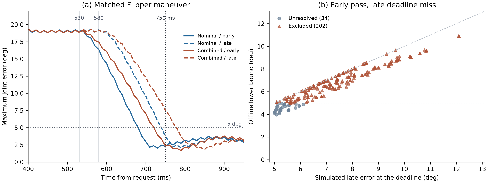

# Flipper deadline-constrained joint recovery simulations

Simulation code, frozen parameters, trajectories, figures, and numerical checks for
*How Late Can a Command Be Sent? Guaranteed Joint Recovery under Speed Limits and Delays*.

The Flipper runs replay the command path from [MECA-SNAKE/flipper-snake at revision ea0a30b](https://github.com/MECA-SNAKE/flipper-snake/tree/ea0a30bfca2e1c8cf9df1145a588155065935d0c).
The actuator models, timing parameters, and measurement traces are synthetic.
The hardware log fields are provided as a template for a later laboratory replay.

| Directory | Contents |
| --- | --- |
| [flipper_simulation_v3](flipper_simulation_v3) | Firmware replay, actuator identification checks, and the 72-trial communication benchmark. |
| [flipper_recovery_boundary_v4](flipper_recovery_boundary_v4) | Predictor fitting, calibration, 1,600 held-out early/late pairs, and matched-case diagnostics. |
| [flipper_scalar_adaptive_boundary_v5](flipper_scalar_adaptive_boundary_v5) | Exact scalar boundary, set-membership calibration, 3,840 numerical trajectories, and the original Flipper four-branch reachable-angle check. |
| [flipper_periodic_audit](flipper_periodic_audit) | Held-out replay and offline reachable-angle audit, matched error trajectories, and the new two-panel figure. |

## Quick verification

From the repository root, with Python 3.12:

~~~sh
python -m pip install -r requirements.txt
python flipper_simulation_v3/verify.py
python flipper_recovery_boundary_v4/verify.py
python flipper_scalar_adaptive_boundary_v5/verify.py
~~~

## Regenerate simulations

The following commands write to a separate rerun directory. The last two
Flipper commands read the frozen v4 fixture and protocol. The v3 and v4
regeneration also reproduce the original fitting pipelines.

~~~sh
python flipper_simulation_v3/study.py --out rerun/v3
python flipper_simulation_v3/verify.py --out rerun/v3
python flipper_recovery_boundary_v4/experiment.py --out rerun/v4
python flipper_recovery_boundary_v4/analyze_results.py --out rerun/v4
python flipper_recovery_boundary_v4/verify.py --out rerun/v4
python flipper_scalar_adaptive_boundary_v5/simulate_boundary.py --out rerun/v5
python flipper_scalar_adaptive_boundary_v5/check_v4_scope.py --v4 flipper_recovery_boundary_v4 --out rerun/v5/v4_scope_check.json
python flipper_scalar_adaptive_boundary_v5/verify.py --out rerun/v5
python flipper_periodic_audit/audit_reachability.py --out rerun/periodic --figures rerun/figures
~~~

The scalar reference data were verified byte for byte with Python 3.12.14 and
NumPy 2.3.5. The periodic figure was generated with Matplotlib 3.11.2.

## Flipper paired replay

The reachability audit uses the originally held-out pairs. It applies the offline
test to the 1,220 pairs whose late branch adopted the command strictly before
the deadline. Of 236 eligible pairs with early recovery and a late deadline miss,
the test certifies that 202 late branches exceed the tolerance even with relaxed
speed requests. The results condition on the simulated state at adoption.

- [Audit counts and illustrated witness](flipper_periodic_audit/results/summary.json)
- [All paired lower bounds](flipper_periodic_audit/results/paired_reachability.csv)
- [The four matched recovery traces](flipper_periodic_audit/results/matched_trajectories.csv)
- [Simulation figure](flipper_periodic_audit/figures/flipper_periodic_audit.png)

